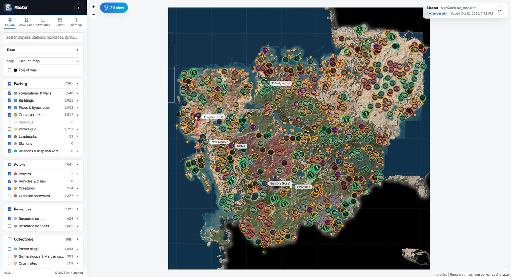
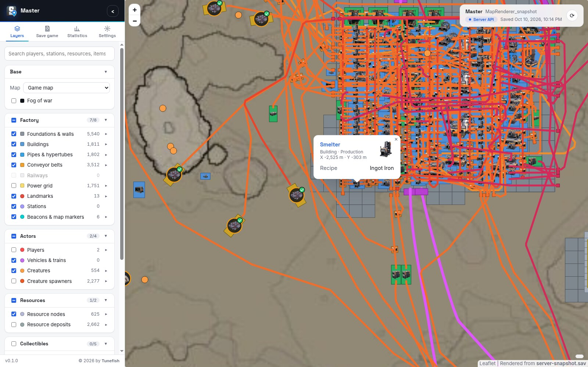
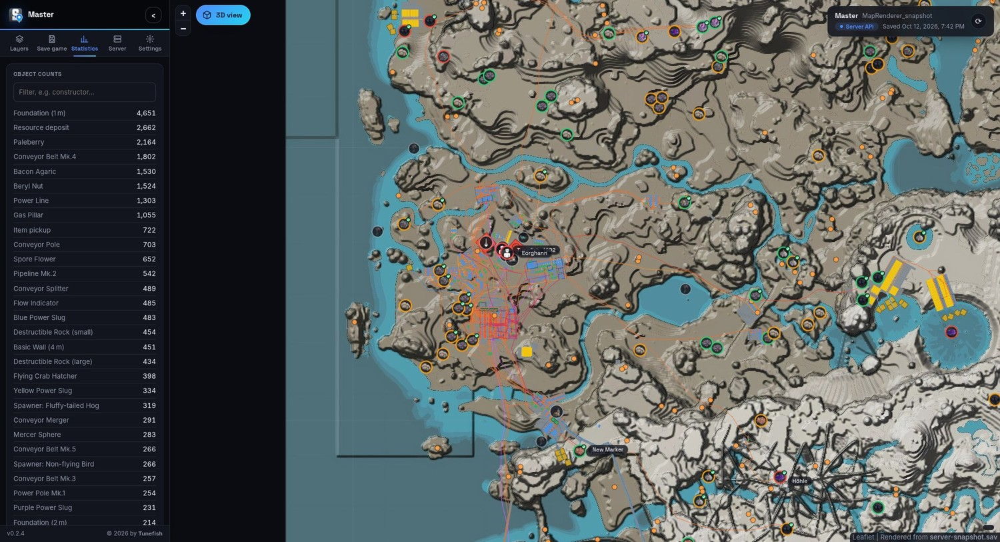

<p align="center"></p>

# Satisfactory Map Renderer

**An interactive map of your Satisfactory save game, in your browser.**

A self-hosted web app: one Docker container reads a save game, renders the whole factory into a zoomable map and
serves it. Load the save by drag and drop, fetch it from a running dedicated server, or copy it over SSH, and
refresh it with one click. Everyone else just opens the page and sees the map.



Questions and help: [Discussions](https://github.com/Tunefish92/SatisfactoryMapRenderer/discussions) ·
Bugs: [Issues](https://github.com/Tunefish92/SatisfactoryMapRenderer/issues) ·
[Changelog](CHANGELOG.md)

## What you get

* **Two base maps**: the in-game map and a relief map with shaded terrain.
* **3D view**: the whole world as a 3D landscape you can rotate and zoom, with your factory standing on it in
  the game's own shapes and textures: machines, foundations, walls, ramps, stations. Belts, pipes, rails and power lines run
  at their real heights, and players, landmarks and stations are labelled.
* **The whole factory**: foundations and walls, buildings (with their game icons when zoomed in), conveyor belts by
  tier, pipes and hypertubes, railways and the power grid.
* **Everything else on the map**: players with their names, vehicles and trains, creatures and their spawners,
  landmarks (HUB, Space Elevator, M.A.M., AWESOME Sink), named stations, beacons and map markers, resource nodes
  with purity and whether they are in use, wells and geysers, power slugs, somersloops and mercer spheres, crash
  sites, plants, dropped items and hazards.
* **Tools**: search, click any building or marker for details (recipe, clock speed, storage contents), layer groups
  with legends and filters, statistics, shareable links, light and dark theme.
* **Save game sources**, chosen by an admin in the page:
  * browse or drag and drop a `.sav` file,
  * a **dedicated server** through its HTTPS API (game version 1.0 or newer, with an API token),
  * **SSH** to the machine that holds the saves.
* **Visitors only see the map.** Choosing and refreshing the save needs the admin password.

Reads saves from Update 5 up to 1.2.4.

| Zoomed in: buildings with their icons, belts, click for details | Dark theme, statistics |
|---|---|
|  |  |

## Installation

### Docker Compose

Save this as `docker-compose.yml`, set a password, and run `docker compose up -d`:

```yaml
services:
  map:
    image: ghcr.io/tunefish92/satisfactorymaprenderer:latest
    restart: unless-stopped
    environment:
      # Required, at least 8 characters. A "$" in the password must be written as "$$" here.
      SMR_ADMIN_PASSWORD: change-me-please
    ports:
      - "8080:8080"
    volumes:
      - ./map-data:/data
      # Optional, read-only: your Satisfactory installation. Only needed when your game is newer
      # than the game data in the image (new items or buildings show without icons).
      # - /path/to/Satisfactory:/game:ro
```

Open `http://localhost:8080/`, click **Admin login** in the *Save game* tab of the side panel, and choose your save
game. The image is also on Docker Hub as `tunefish92/satisfactorymaprenderer`.

### The admin password

The password may contain **any characters** and needs at least 8 of them. It is compared exactly: upper and lower
case matter, and so do spaces at the beginning or end.

**Mind the `$` in Docker Compose.** Compose reads `$` in `docker-compose.yml` and in `.env` as the start of a
variable and changes the password without telling you. The login then fails with the password you believe you set:

| Written in `docker-compose.yml` or `.env` | Password the app gets |
|---|---|
| `pa$word123` | `pa` |
| `pa${word}123` | `pa123` |
| `pa$$word123` | `pa$word123` |

There are two ways around it:

1. Write `$$` for every `$` of the password, as in the last row.
2. Keep the password in its own file, which Compose passes on unchanged (needs Docker Compose 2.30 or newer).
   Create `admin.env` next to `docker-compose.yml`:

   ```
   SMR_ADMIN_PASSWORD=your password, exactly as it is
   ```

   and replace the `environment:` entry for the password with:

   ```yaml
       env_file:
         - path: admin.env
           format: raw
   ```

   Everything after the `=` is the password: no quotes are needed, and `$`, `#`, quotes and spaces are ordinary
   characters there.

With `docker run -e` and on Unraid, Compose is not involved; quote the password for your shell as usual.

### Unraid

**From the Apps tab.** Search for *Satisfactory Map Renderer* in Community Applications and click *Install*. The
template lives in [Tunefish92/unraid-templates](https://github.com/Tunefish92/unraid-templates); a copy is in
[`unraid/`](unraid/satisfactory-map-renderer.xml).

**If it is not listed (yet).** Put the template on the flash drive yourself, from the Unraid terminal:

```
wget -O /boot/config/plugins/dockerMan/templates-user/my-Satisfactory-Map-Renderer.xml \
  https://raw.githubusercontent.com/Tunefish92/unraid-templates/main/templates/satisfactory-map-renderer.xml
```

Then open the **Docker** tab, click **Add Container** and choose *Satisfactory-Map-Renderer* from the
**Template** list.

**Settings in the template**

| Setting | Default | Meaning |
|---|---|---|
| WebUI Port | `8080` | Port the map is served on. Change it if another container already uses 8080. |
| Data Path | `/mnt/user/appdata/satisfactory-map-renderer` | The rendered map, settings and fetched saves. |
| Admin Password | – | **Required**, at least 8 characters, any characters. Unraid passes it on unchanged, so `$` needs no escaping here. |
| Game Folder | empty | Normally not needed, see [Game icons and the in-game map](#game-icons-and-the-in-game-map). |
| Max Zoom | `9` | Under *Show more settings*. Lower it to render faster and save disk space. |
| PUID / PGID | `99` / `100` | Under *Show more settings*. Unraid's `nobody:users`, so the files in appdata have the usual owner. |

Click **Apply**, then open the map from the container's **WebUI** menu entry and log in under *Save game* →
*Admin login*.

**With a dedicated server on the same Unraid box**, for example the `ich777/steamcmd:satisfactory` container:

* *HTTPS API (recommended)*: in the map's *Save game* tab enter your Unraid server's IP address as host and the
  server's game port (7777 by default; it must be mapped for TCP as well as UDP). Create the API token in the
  game: *Server Manager* → *Console* → `server.GenerateAPIToken`. Leave "Verify certificate" off.
* *SSH*: possible, but needs a key in `appdata/satisfactory-map-renderer/home/.ssh/` and SSH access to Unraid.
  With that container the saves are in
  `/mnt/user/appdata/satisfactory/.config/Epic/FactoryGame/Saved/SaveGames/server/` (the path depends on where
  you mapped the server files).

### From this repository

```
cp admin.env.example admin.env      # put the admin password into it
docker compose up -d --build
```

The repository's compose file already uses the `admin.env` approach from above. Optional settings (port, data
folder, zoom) go into `.env`; see `.env.example`.

## Choosing the save game

* **File**: *Browse…* or drop a `.sav` anywhere on the page.
* **Dedicated server (HTTPS API)**: host, port (7777 by default) and an API token. Create the token in the server
  console with `server.GenerateAPIToken`. Servers use a self-signed certificate by default, so "Verify
  certificate" is off unless you switch it on. With "Save the running game first" the server writes a save named
  `MapRenderer_snapshot` (overwritten each time), so the map shows the current state; otherwise the newest
  existing save is taken. *Check version* shows the server's name, build and game version and whether it is
  supported. The API exists from game version 1.0 on; older servers need SSH or a file.
* **SSH**: `user@host`, port and the path of a save file or of the folder with the saves (the newest `.sav` below it
  is taken). It uses the container's `ssh` with keys from `map-data/home/.ssh/`; passwords are not supported. A
  host is trusted the first time it is seen.
* **Refresh snapshot** (also the ⟳ button at the top right of the map) fetches and renders the save again.

While a save is loaded, a progress window shows what is happening. Connection settings, including the API token,
are stored in the data folder (`cache/source.json`), readable by the app's user only.

## Game icons and the in-game map

The image works **out of the box**: it brings the game's icons, item and building names, resource data and the
in-game map, exported from Satisfactory 1.2.4. No game installation is needed.

The **3D** button under the zoom buttons opens the 3D view: the game's height data as a landscape, and
the factory in the game's own 3D models, placed with the positions and rotations from the save. The
ground shows the game's own ground textures where the game's landscape has them painted, with the sea, lakes
and rivers as water; untick **Realistic ground** to see the in-game map on the terrain instead. Steep faces get
the game's cliff texture, because the game's rocks are separate objects that the ground data does not cover. The
models carry the game's textures, the machines in the standard FICSIT orange (custom paint from the save is not shown). Belts, pipes, rails and
wires are simple strips at their real heights, and the few building types without a model are boxes. Drag to
rotate, drag with the wheel button or Shift+drag to move, wheel to zoom towards the mouse; each factory layer can be switched off. Heights are
the real ones, not exaggerated. It needs a browser with WebGL 2 and, for a large factory, a dedicated graphics card.

The *Map* dropdown on the Layers tab switches between the **game map** and a **relief map**: the same map with the
terrain shaded from the game's own height data, so mountains, cliffs, canyons and craters stand out.

When the game gets an update that the image does not know yet, new items and buildings appear without icons
until the image is updated. To use your own game's data in the meantime, mount your Satisfactory installation
read-only at `/game` (the folder that contains `FactoryGame` and `CommunityResources`) and delete
`map-data/gamedata/` if it exists: on the next start the data is exported into `map-data/gamedata/`, which from
then on is used instead of the bundled data. The mount can be removed again afterwards.

Optional images in `map-data/maps/` replace or add base maps, each covering the whole in-game map area:
`game-map.jpg` (used instead of the bundled in-game map), `relief-map.jpg` (used instead of the bundled relief map,
for example a higher-resolution one) and `realistic-map.jpg` (offered as a further base map in the *Map*
dropdown).

## Settings

| Variable | Default | Meaning |
|---|---|---|
| `SMR_ADMIN_PASSWORD` | – | **Required**, at least 8 characters, any characters (see [The admin password](#the-admin-password)). Only admins can choose or refresh the save game. Five wrong passwords block the login for a minute. |
| `SMR_MAX_ZOOM` | `9` | Highest rendered zoom level (3–9). 9 is about 6 cm per pixel; each level less renders about four times faster and needs a quarter of the disk space. |
| `PUID` / `PGID` | `1000` | Owner of the data folder; the app runs as this user. |

| Path | Meaning |
|---|---|
| `/data` | Everything the app keeps: `map/` (the rendered map), `gamedata/`, `maps/`, `cache/` (settings, fetched saves), `home/` (with `.ssh`). |
| `/game` | Optional, read-only: a Satisfactory installation, to export newer game data than the image has. |

**On the internet.** The container speaks plain HTTP on port 8080. Put it behind a reverse proxy that adds HTTPS
and forwards `Host` and `X-Forwarded-Proto`; otherwise the admin password travels unencrypted.

**Updates.** For admins the page checks this project's GitHub releases, at most every six hours, and shows a
banner when a newer version is out. The *Settings* tab has the switches "Check for updates on GitHub" and "Include
pre-releases". The check is a request from the admin's browser to `api.github.com`; visitors never make it.

## Limitations

* Building footprints come from a built-in table and are approximate; unknown buildables fall back to size
  heuristics.
* A dedicated server offers no live feed. "Live" means fetching and rendering a new snapshot, about half a minute
  for a large factory at the default zoom.

## Development

The app is one .NET 10 project: a save parser, a SkiaSharp tile renderer and a small HTTP server that serves the
viewer (plain HTML/CSS/JS with Leaflet, bundled).

```
dotnet run --project src/SatisfactoryMapRenderer -c Release -- --serve 8000 -o output/map
```

serves it at `http://localhost:8000/`. On localhost no admin password is needed; `--bind '*'` listens on all
interfaces and requires one. `--help` lists every option, among them `--game <dir>` and `--export-game-data` for
the game's assets and `--dump-json` to write the completely decoded save as JSON.

```
dotnet test --solution SatisfactoryMapRenderer.slnx          # parser, extraction, rendering (xUnit v3)
node tests/viewer/viewer-smoke.mjs <output>/index.html       # clicks through the viewer in a headless browser
```

* The tests build complete synthetic `.sav` files in memory for 10 save versions (Update 5 → 1.2.4, both property
  tag formats); each is parsed, turned into map features and exported to tiles. Corrupt and truncated files must
  produce a clean `SaveFormatException`.
* `RealSaveTests` checks real saves for full decoding: set `SMR_TEST_SAVES=a.sav;b.sav`.
* The browser smoke test needs a Chromium-based browser (`BROWSER=/path/to/browser`).

```
src/SatisfactoryMapRenderer/
  Save/          binary reader, header, chunk decompression, levels/objects, property decoder, JSON dump
  World/         class catalog (names, categories, footprints) and save → map feature extraction
  Game/          reading icons, names and level data from a game installation
  Rendering/     tile renderer, viewer export
  Serve/         HTTP server, admin login, dedicated server API client, SSH
  Assets/        the viewer and bundled Leaflet
docs/SAVE_FORMAT.md   save file format reference, including all version differences
```

Releases: a tag `v1.2.3` builds the image for amd64 and arm64 and publishes it to GHCR and, when the repository
variable `DOCKERHUB_USERNAME` and the secret `DOCKERHUB_TOKEN` are set, to Docker Hub. A tag with a hyphen
(`v1.3.0-beta.1`) is a pre-release and does not move `latest`.

## Licence and credits

The code is under the [MIT licence](LICENSE).

The game data in [`gamedata/`](gamedata/) (icons, names, level data, logo, in-game map) and the map and icons
visible in the screenshots are the property of Coffee Stain Studios and are **not** covered by that licence. They
are included so that this fan-made tool can display save games of their game. This project is not affiliated with
or endorsed by Coffee Stain Studios.
